```{r child="setup.Rmd"}
```

class: inverse, center, middle

# Uma lista de tarefas não mostra dependências!

.large[Se você tem 5 coisas para fazer, você pode simplesmente somar o tempo de tudo?]

???

**Pergunta para a turma:**
"Imagine que a turma precisa organizar a Feira de Ciências da escola ou uma festa surpresa. Temos 5 tarefas. Se cada uma leva 2 dias, o projeto vai demorar 10 dias no total?"
- Resposta: **Não obrigatoriamente!** Porque várias pessoas podem fazer tarefas diferentes ao mesmo tempo (em paralelo).
- Mas atenção: você não pode pintar o cartaz antes de comprar a cartolina! É isso que chamamos de **dependência**.

---

# O que vamos descobrir nesta aula?

.pull-left[
- **O que é um projeto:** a diferença entre a rotina diária e um desafio com começo, meio e fim;
- **O mapa da rede (AON):** tarefas desenhadas como caixinhas e setas para enxergar dependências;
- **Ida e Volta:** como calcular o instante exato em que cada etapa começa e termina;
- **Caminho Crítico (CPM):** a sequência sem margem de atraso que governa a data final!
]

.pull-right[
- **Folga de tempo:** o colchão de segurança para imprevistos sem atrasar a entrega;
- **Incerteza com PERT:** como planejar quando temos estimativas otimistas, prováveis e pessimistas;
- **Aceleração (*Crashing*):** onde colocar reforço para encurtar prazos com inteligência;
- **Conexão com o PCP:** como indústrias reais equilibram pessoas, materiais e máquinas.
]

.clear[]

---

class: compact

# Rotina vs. Projeto: qual é a diferença?

No mundo da produção e da vida real, fazemos duas coisas muito diferentes:

.pull-left[
### 🔄 Rotina (Operação contínua)
- Fazer pão de queijo na padaria todo dia;
- Montar celulares em uma linha de montagem contínua;
- Tarefas **repetitivas**, padronizadas e sem data final marcada;
- Objetivo: **manter o ritmo e a qualidade**.
]

.pull-right[
### 🚀 Projeto (Evento único)
- Organizar a Feira de Ciências da escola;
- Construir uma ponte ou um novo laboratório;
- Desenvolver um aplicativo novo ou instalar uma máquina nova;
- Tem **início, meio e fim**, equipe dedicada e prazo fixo!
]

.clear[]

.decision[**Moral da história:** Uma fábrica precisa da **rotina** para produzir todos os dias e de **projetos** para criar produtos novos e melhorar suas máquinas!]

---

class: compact

# CPM e PERT: duas ferramentas para gerenciar projetos

Na década de 1950, engenheiros criaram dois métodos geniais para nunca mais perderem prazos:

| Método | Como funciona o tempo? | Quando a gente usa? | Pergunta que ele responde |
|---|---|---|---|
| **CPM**<br>*(Método do Caminho Crítico)* | **Tempo com certeza (fixo)**<br>Ex: *"comprar o material demora exatamente 4 dias"*. | Em reformas, manutenções conhecidas e montagens já testadas. | *"Quais tarefas não podem atrasar nem 1 minuto para não estragar a entrega final?"* |
| **PERT**<br>*(Técnica de Avaliação e Revisão de Projetos)* | **Tempo com incerteza (3 palpites)**<br>Otimista (*o*), Mais Provável (*m*) e Pessimista (*p*). | Em pesquisas inéditas, projetos de tecnologia ou quando dependemos de fornecedores novos. | *"Qual é a duração média mais realista considerando os riscos de imprevistos?"* |

.question[Em um projeto real, usamos os dois juntos: usamos tempos fixos para o que já conhecemos e calculamos médias com o PERT nas tarefas mais arriscadas!]

---

# Os blocos para montar a nossa rede de tarefas

Para não se perder, todo projeto é desenhado como um **mapa de trânsito** de atividades:

.pull-left[
- **Atividade (Tarefa):** Qualquer trabalho que consome tempo e esforço (ex: *"Comprar tintas"*).
- **Predecessora:** A tarefa que precisa terminar **antes** da próxima começar (ex: você não pode pintar o muro antes de lixar!).
- **Sucessora:** A tarefa que é liberada logo após outra ser concluída.
- **Duração:** Quantos dias ou horas a tarefa leva para ser feita.
]

.pull-right[
- **Tarefas em série:** Acontecem uma depois da outra (A → B).
- **Tarefas em paralelo:** Acontecem ao mesmo tempo com pessoas diferentes (A e B juntas).
- **Divisão (Divergência):** Uma tarefa termina e libera duas ou mais ao mesmo tempo.
- **Junção (Convergência):** Uma tarefa precisa de duas ou mais anteriores concluídas para poder começar!
]

.clear[]

.decision[**Atenção na Junção:** Se você precisa do trabalho de dois colegas para começar a sua parte, você é obrigado a **esperar o mais demorado** terminar!]

---

# Como ler o mapa da rede (Método AON)

.pull-left[
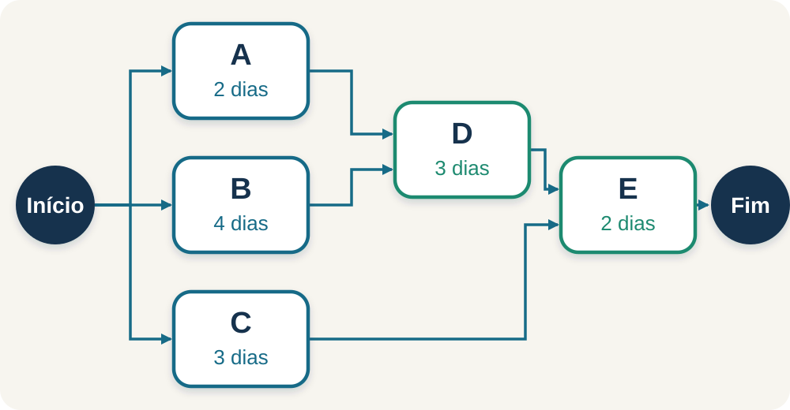
]

.pull-right[

**Regras simples de leitura:**

- Cada **caixinha (nó)** representa uma tarefa;
- Cada **seta** mostra quem libera quem;
- Onde as setas se dividem: trabalhos acontecendo em paralelo;
- Onde as setas se juntam: dependência de múltiplas entregas.

.question[**Desafio rápido:** Olhe a figura ao lado. As tarefas A, B e C podem começar juntas no dia zero? A tarefa D pode começar assim que A terminar?]
]

???

**Respostas esperadas:**
- Sim! A, B e C não dependem de ninguém, então começam juntas no tempo zero.
- Não! A tarefa D depende de A e de B. Mesmo que A termine rápido, D é obrigada a esperar B terminar!

---

class: compact

# A caixinha da tarefa (Anatomia do Nó)

Para calcular tudo sem errar, cada caixinha guarda 6 informações organizadas:

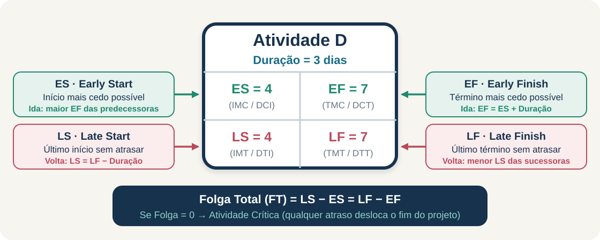

.pull-left[
**Linha de cima · Caminhada para a Frente (IDA):**
- **ES = IMC / DCI:** Início Mais Cedo (Data Mais Cedo de Início) — primeiro dia possível.
- **EF = TMC / DCT:** Término Mais Cedo (Data Mais Cedo de Término) — dia em que termina.
]

.pull-right[
**Linha de baixo · Caminhada para Trás (VOLTA):**
- **LS = IMT / DTI:** Início Mais Tarde (Data Mais Tarde de Início) — prazo limite para começar.
- **LF = TMT / DTT:** Término Mais Tarde (Data Mais Tarde de Término) — prazo limite para terminar.
]

.clear[]

.decision[**No meio da caixa:** Nome, duração e **Folga Total (FT = LS − ES = LF − EF)**.]

---

class: inverse, center, middle

# Exemplo Guiado 1 · Montando uma Estação de Trabalho

.large[Vamos calcular a rede passo a passo, da ida até a volta!]

---

# Dados do Exemplo 1

Imagine que a equipe da escola vai instalar uma estação de computadores e robótica:

| Tarefa | O que é feito? | Quem precisa terminar antes? (Predecessora) | Duração |
|---|---|---|---:|
| **A** | Limpar e preparar a sala | Nenhuma | 2 dias |
| **B** | Receber e conferir os computadores | Nenhuma | 4 dias |
| **C** | Passar os cabos de internet | Nenhuma | 3 dias |
| **D** | Montar os computadores nas mesas | Precisa de **A** e de **B** | 3 dias |
| **E** | Testar o sistema e liberar para uso | Precisa de **C** e de **D** | 2 dias |

.activity[**Pense rápido:** Se somarmos todas as durações ($2 + 4 + 3 + 3 + 2$), daria **14 dias**. Mas será que precisamos mesmo de 14 dias para concluir tudo?]

---

# O mapa da rede e todos os caminhos possíveis

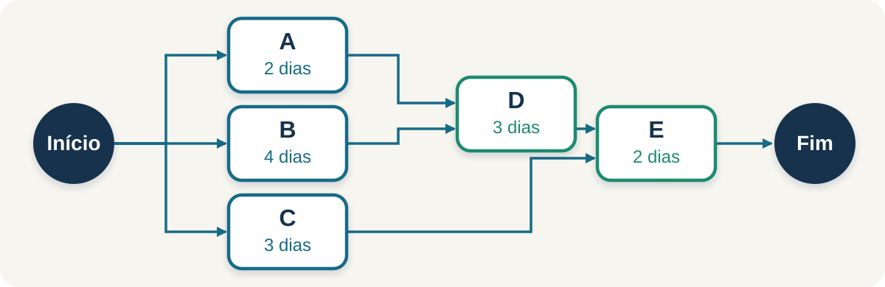

.pull-left[
**Vamos somar o tempo de cada caminho do Início ao Fim:**
- **Caminho 1:** A → D → E = 2 + 3 + 2 = **7 dias**
- **Caminho 2:** B → D → E = 4 + 3 + 2 = **9 dias** *(O mais demorado!)*
- **Caminho 3:** C → E = 3 + 2 = **5 dias**
]

.pull-right[
.warning[**O segredo revelado:**  
O projeto só termina quando **todos** os caminhos forem concluídos!  
Como o Caminho 2 leva **9 dias**, o projeto vai demorar exatamente **9 dias** (e não 14 dias!).]
]

---

# 1º Passo: A Caminhada para a Frente (A Ida)

Partimos do dia zero ($t = 0$) e caminhamos da esquerda para a direita:

<div class="formula">Término Mais Cedo (EF) = Início Mais Cedo (ES) + Duração</div>

.pull-left[
### A Regra de Ouro da Ida:
Quando uma tarefa depende de duas ou mais anteriores (uma **junção**):
<div class="formula">ES = MAIOR EF entre as tarefas anteriores</div>
]

.pull-right[
### Por que usamos o MAIOR?
Porque se a tarefa D precisa de A (que acaba no dia 2) e de B (que acaba no dia 4), D não pode começar no dia 2!  
Ela é obrigada a esperar a entrega de B no dia 4!
]

---

class: compact

# Calculando a Ida na prática

.pull-left[
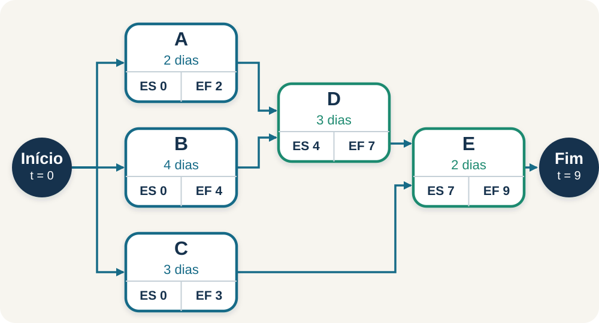
]

.pull-right[
**Contas da esquerda para a direita (Ida):**

1. **A, B e C** iniciam em $t = 0$:
   - Término: A = $0 + 2 = \mathbf{2}$; B = $0 + 4 = \mathbf{4}$; C = $0 + 3 = \mathbf{3}$.
2. **Tarefa D (espera A e B):**
   - Regra do maior: Início de D = $\max(2, 4) = \mathbf{4}$;
   - Término de D = $4 + 3 = \mathbf{7\text{ dias}}$.
3. **Tarefa E (espera C e D):**
   - Início de E = $\max(3, 7) = \mathbf{7}$;
   - Término de E = $7 + 2 = \mathbf{9\text{ dias}}$.
]

.clear[]

.decision[**Resultado da ida:** O projeto tem duração mínima de **9 dias**!]

---

# 2º Passo: A Caminhada para Trás (A Volta)

Agora começamos no dia final ($t = 9$) e voltamos da direita para a esquerda:

<div class="formula">Início Mais Tarde (LS) = Término Mais Tarde (LF) − Duração</div>

.pull-left[
### A Regra de Ouro da Volta:
Quando uma tarefa libera duas ou mais tarefas seguintes (uma **divisão**):
<div class="formula">LF = MENOR LS entre as tarefas seguintes</div>
]

.pull-right[
### Por que usamos o MENOR?
Porque na volta respeitamos a tarefa mais apressada!  
Se você entregar mais tarde do que a próxima tarefa precisa, ela vai atrasar e o projeto inteiro estoura o prazo!
]

---

class: compact

# Calculando a Volta na prática

.pull-left[
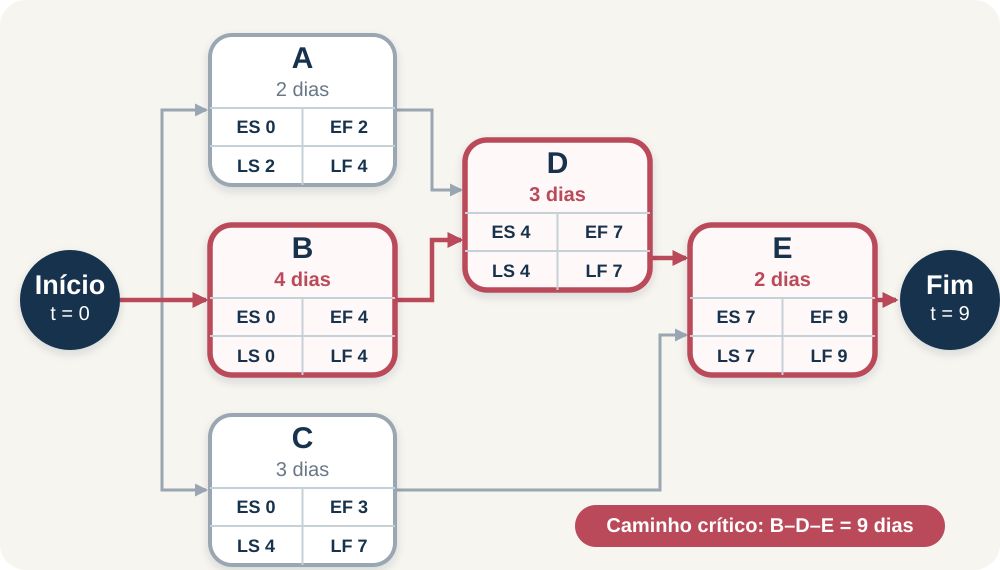
]

.pull-right[
**Contas da direita para a esquerda (Volta):**

1. **Tarefa final E:** Término limite = 9 dias
   - Início limite de E = $9 - 2 = \mathbf{7\text{ dias}}$.
2. **Tarefas D e C (entregam para E):** Limite = 7 dias
   - Início limite de D = $7 - 3 = \mathbf{4\text{ dias}}$;
   - Início limite de C = $7 - 3 = \mathbf{4\text{ dias}}$.
3. **Tarefas A e B (entregam para D):** Limite = 4 dias
   - Início limite de B = $4 - 4 = \mathbf{0\text{ dias}}$;
   - Início limite de A = $4 - 2 = \mathbf{2\text{ dias}}$.
]

.clear[]

.decision[**Resultado da volta:** Descobrimos o prazo limite de cada tarefa!]

---

class: compact

# O Grande Encontro: Folga e Caminho Crítico!

A **Folga** é a diferença entre o dia limite máximo e o dia mais cedo:

<div class="formula">Folga Total (FT) = LS − ES = LF − EF &nbsp;·&nbsp; (IMT − IMC = TMT − TMC)</div>

.pull-left[
| Tarefa | Duração | Mais Cedo (ES) | Mais Tarde (LS) | Folga de Tempo | Ela é Crítica? |
|---|---:|---:|---:|---:|---|
| **A** | 2 dias | 0 | 2 | **2 dias** | Não (tem folga!) |
| **B** | 4 dias | 0 | 0 | **0 dias** | **CRÍTICA!** 🚨 |
| **C** | 3 dias | 0 | 4 | **4 dias** | Não (tem folga!) |
| **D** | 3 dias | 4 | 4 | **0 dias** | **CRÍTICA!** 🚨 |
| **E** | 2 dias | 7 | 7 | **0 dias** | **CRÍTICA!** 🚨 |
]

.pull-right[
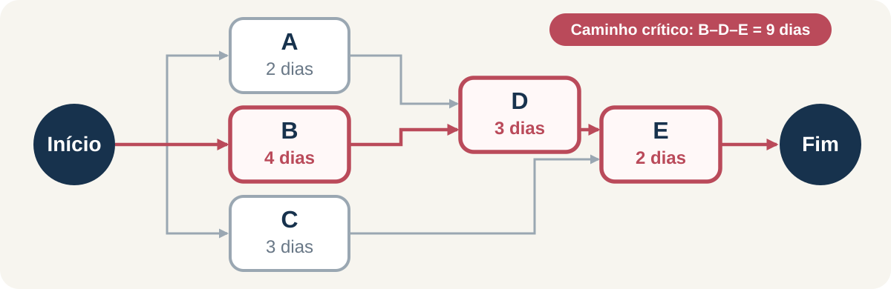

.decision[O **Caminho Crítico** é formado pelas tarefas com **Folga Zero**: **B → D → E** (9 dias)!  
É o caminho que não tem gordura nenhuma!]
]

---

# O que significa ser "Crítica" na vida real?

.pull-left[
### 🚨 Tarefas Críticas (B, D e E)
- Têm **Folga = 0**;
- Se qualquer pessoa atrasar essas tarefas em **1 único dia**, o projeto inteiro atrasa 1 dia!
- São as tarefas que o líder do projeto deve acompanhar de perto todos os dias.
]

.pull-right[
### ⏳ Tarefas Não Críticas (A e C)
- Têm **Folga positiva** (A tem 2 dias; C tem 4 dias);
- Se a tarefa A atrasar 1 ou 2 dias por causa de chuva, o prazo final do projeto **não muda**!
- Essa folga serve como um "colchão de segurança" para imprevistos.
]

.clear[]

.question[**Pergunta surpresa:** Se a tarefa A atrasar 3 dias, o que acontece?  
*Resposta:* Como A só tinha 2 dias de folga, o 3º dia estoura a folga e atrasa o projeto em 1 dia!]

---

# Olhando o tempo no Gráfico de Gantt

O **Gráfico de Gantt** é como uma linha do tempo onde cada tarefa vira uma barra horizontal:

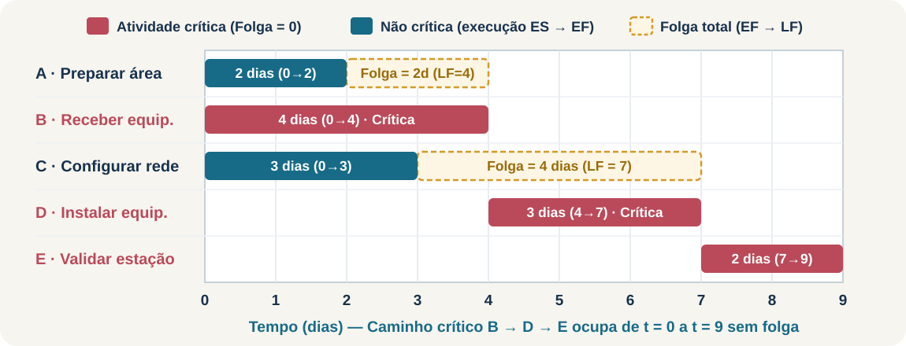

- **Barras cheias:** Mostram o período em que a equipe está trabalhando na tarefa;
- **Barras tracejadas:** Mostram a **folga** (o tempo que a tarefa pode escorregar para a direita sem atrapalhar ninguém);
- Observe como **B, D e E** formam uma escada perfeita de 0 a 9 sem nenhum espaço em branco!

---

class: inverse, center, middle

# Desafio Prático Completo · Projeto com 9 Tarefas (A a I)

.large[Um projeto maior para ver se você realmente pegou o jeito!]

---

class: compact, dense-table

# As 9 Tarefas do Projeto da Indústria

| Tarefa | O que é feito? | Duração | Predecessoras (Quem vem antes?) |
|---|---|---:|---|
| **A** | Planejar o projeto e definir metas | 1 dia | Nenhuma (inicia tudo) |
| **B** | Desenhar as peças mecânicas | 4 dias | Depende de A |
| **C** | Escolher os sensores e fios elétricos | 3 dias | Depende de A |
| **D** | Comprar chapas e vigas de aço | 7 dias | Depende de A |
| **E** | Cortar e soldar a estrutura | 6 dias | Depende de B |
| **F** | Ligar e testar os sensores | 2 dias | Depende de C e D |
| **G** | Juntar a parte mecânica com a elétrica | 7 dias | Depende de E e F |
| **H** | Testes de resistência e peso | 9 dias | Depende de D |
| **I** | Teste geral e entrega do equipamento | 4 dias | Depende de G e H |

.activity[**Desafio em duplas:** Vamos desenhar a rede e descobrir quais são todos os caminhos do Início ao Fim!]

---

class: compact

# A Rede com as 9 Tarefas e os 4 Caminhos

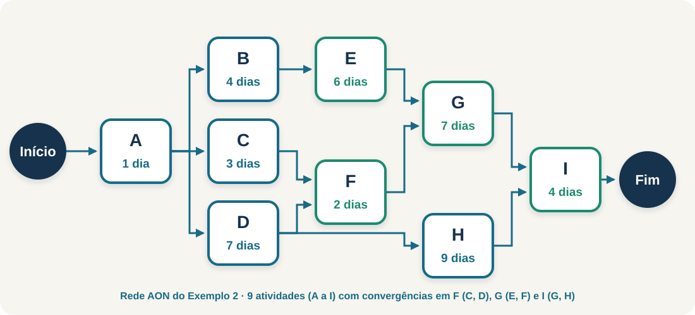

.pull-left[
**Caminho 1:** A → B → E → G → I  
$1 + 4 + 6 + 7 + 4 =$ **22 dias** 👑 *(Caminho Crítico!)*

**Caminho 2:** A → C → F → G → I  
$1 + 3 + 2 + 7 + 4 =$ **17 dias**
]

.pull-right[
**Caminho 3:** A → D → F → G → I  
$1 + 7 + 2 + 7 + 4 =$ **21 dias** *(Quase crítico!)*

**Caminho 4:** A → D → H → I  
$1 + 7 + 9 + 4 =$ **21 dias** *(Quase crítico!)*
]

.clear[]

.decision[O projeto demora **22 dias**! Mas repare nos Caminhos 3 e 4: eles levam 21 dias, o que significa que têm apenas **1 mísero dia de folga**!]

---

class: compact

# A Ida no Projeto de 9 Tarefas

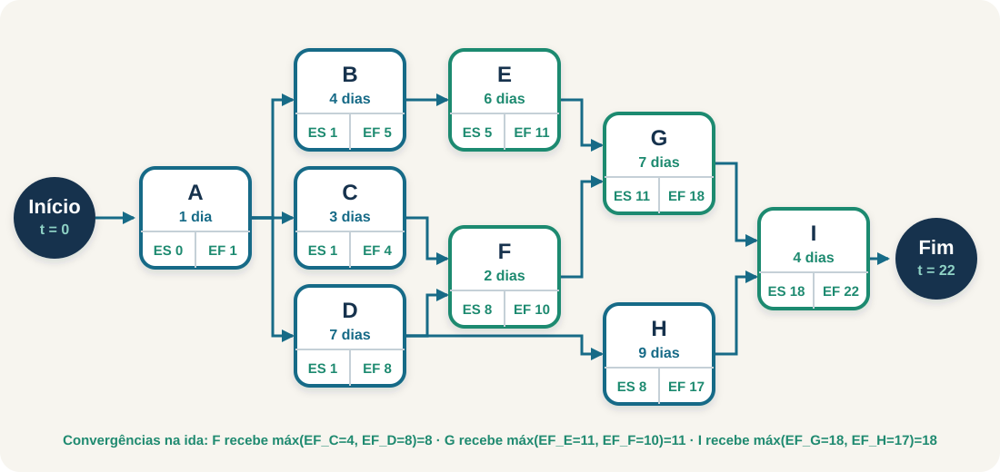

.pull-left[
- **A** começa em 0 e termina no dia 1;
- **B, C e D** começam no dia 1:
  - B acaba em 5; C acaba em 4; D acaba em 8;
- **E** (após B): começa em 5 e acaba em $5 + 6 = 11$;
- **F** (depende de C=4 e D=8): espera o maior (8)! Acaba em $8 + 2 = 10$;
]

.pull-right[
- **G** (depende de E=11 e F=10): espera o maior (11)! Acaba em $11 + 7 = 18$;
- **H** (após D=8): acaba em $8 + 9 = 17$;
- **I** (depende de G=18 e H=17): espera o maior (18)! Acaba em $18 + 4 =$ **22 dias**!
]

---

class: compact

# A Volta e o Caminho Crítico Revelado

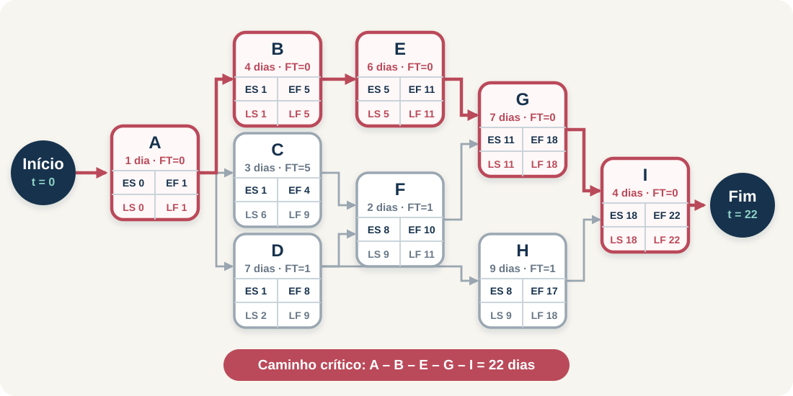

.pull-left[
- Começamos fixando o fim em **22 dias**;
- Voltamos calculando os prazos limites;
- As tarefas com **Folga Zero** formam o Caminho Crítico contínuo:  
  **A → B → E → G → I** (22 dias)!
]

.pull-right[
- As tarefas **D, F e H** têm apenas **1 dia de folga**;
- A tarefa **C** é a mais tranquila, com **5 dias de folga**!
]

.clear[]

.decision[Se qualquer tarefa do caminho crítico (A, B, E, G ou I) atrasar, o projeto todo atrasa. Mas e se uma tarefa quase crítica atrasar?]

---

class: compact, dense-table

# Tabela das 9 Tarefas: Resumo Geral

| Tarefa | Duração | Cedo (ES) | Cedo (EF) | Tarde (LS) | Tarde (LF) | Folga | Situação da Tarefa |
|---|---:|---:|---:|---:|---:|---:|---|
| **A** | 1 dia | 0 | 1 | 0 | 1 | **0** | 🚨 **Crítica** (folga zero) |
| **B** | 4 dias | 1 | 5 | 1 | 5 | **0** | 🚨 **Crítica** (folga zero) |
| **C** | 3 dias | 1 | 4 | 6 | 9 | **5** | 🟢 Tranquila (folga 5d) |
| **D** | 7 dias | 1 | 8 | 2 | 9 | **1** | 🟡 Quase crítica (folga 1d) |
| **E** | 6 dias | 5 | 11 | 5 | 11 | **0** | 🚨 **Crítica** (folga zero) |
| **F** | 2 dias | 8 | 10 | 9 | 11 | **1** | 🟡 Quase crítica (folga 1d) |
| **G** | 7 dias | 11 | 18 | 11 | 18 | **0** | 🚨 **Crítica** (folga zero) |
| **H** | 9 dias | 8 | 17 | 9 | 18 | **1** | 🟡 Quase crítica (folga 1d) |
| **I** | 4 dias | 18 | 22 | 18 | 22 | **0** | 🚨 **Crítica** (entrega final) |

---

# O Gráfico de Gantt do Projeto de 9 Tarefas

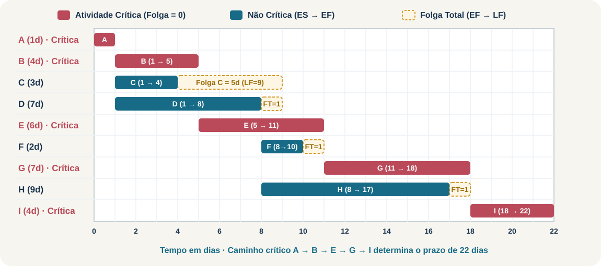

- As tarefas vermelhas (**A, B, E, G e I**) não têm nenhum espaço sobrando;
- As tarefas com barras pontilhadas (**C, D, F e H**) mostram onde a equipe pode ter uma folga sem prejudicar a data final de 22 dias!

---

class: compact

# Teste de Fogo: E se a tarefa F demorar 4 dias em vez de 2?

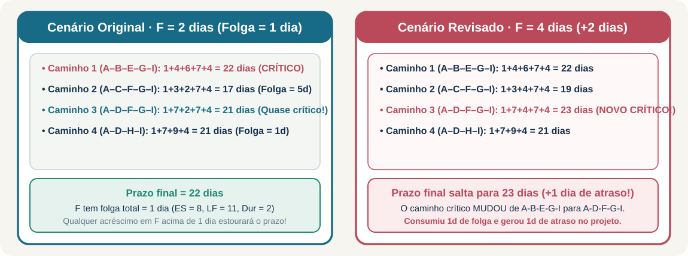

.pull-left[
- A tarefa **F** tinha originalmente **1 dia de folga**;
- Se ela demorar **4 dias** (+2 dias de atraso):
  - Ela gasta o 1 dia de folga que tinha...
  - E ainda sobra **1 dia de atraso real**!
]

.pull-right[
- O Caminho 3 (A–D–F–G–I) salta de 21 para **23 dias**!
- Como 23 é maior que 22, o **Caminho Crítico MUDOU**!
]

.clear[]

.warning[**Lição valiosa:** Cuidado com tarefas que têm folga pequena! Se você não prestar atenção nelas, elas viram o novo gargalo do seu projeto!]

---

class: compact

# E se precisarmos entregar o projeto mais rápido? (*Crashing*)

Imagine que a direção da escola ou o cliente precisa do projeto pronto **2 dias antes** do prazo. O que fazer?

.pull-left[
### ❌ O que NÃO adianta fazer:
- Colocar mais pessoas na tarefa **C** (ela já tem 5 dias de folga!).
- Acelerar tarefas que têm folga só gasta energia e dinheiro, mas **não diminui o prazo final**!
]

.pull-right[
### ✔️ A Regra de Ouro da Aceleração:
- **Só adianta acelerar tarefas do Caminho Crítico!**
- Escolha a tarefa crítica mais fácil ou mais barata de adiantar (ex: fazer hora extra em B ou E).
- **Atenção:** Ao encurtar o caminho crítico, outro caminho paralelo pode empatar e virar crítico também!
]

---

class: inverse, center, middle

# E quando ninguém sabe o tempo exato? O Método PERT!

.large[Lidando com a incerteza e os imprevistos da vida real]

---

# O Método PERT: Trabalhando com 3 Estimativas

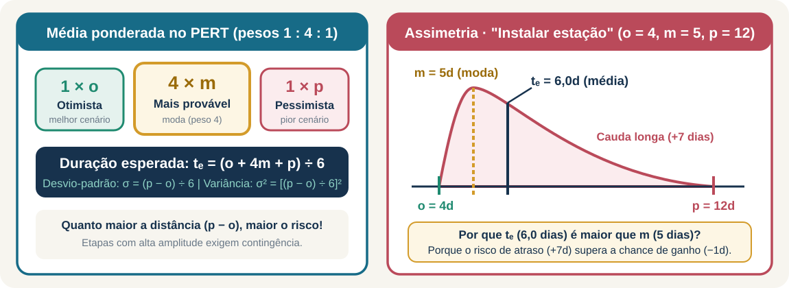

Em vez de fingir que temos certeza absoluta, pedimos para a equipe **três palpites**:

1. **Otimista ($o$):** Se tudo der certo, sem trânsito, sem peças quebradas;
2. **Mais Provável ($m$):** O que costuma acontecer na maioria das vezes;
3. **Pessimista ($p$):** Se der quase tudo errado (chuva, atraso de entrega, retrabalho).

---

class: compact

# A Fórmula do Tempo Esperado no PERT

Para calcular a duração média mais justa, usamos uma média ponderada genial:

<div class="formula">Duração Esperada (tₑ) = (o + 4 × m + p) ÷ 6</div>

.pull-left[
### Por que o 4 está no $m$?
Damos **peso 4** para o cenário Mais Provável porque ele é o mais realista. O otimista e o pessimista têm peso 1 cada. Somando os pesos ($1 + 4 + 1 = 6$), dividimos por 6!
]

.pull-right[
### Exemplo Prático:
- Tarefa: Montar a estrutura da feira.
- Otimista = 2 dias | Mais Provável = 3 dias | Pessimista = 10 dias.
$$t_e = \frac{2 + 4 \times 3 + 10}{6} = \frac{2 + 12 + 10}{6} = \frac{24}{6} = \mathbf{4\text{ dias}}$$
]

.decision[Se você usasse apenas o palpite normal (3 dias), você seria pego de surpresa! O PERT nos protege contra o otimismo ingênuo!]

---

class: compact

# Armadilhas comuns que você nunca deve cometer!

| O erro que muita gente comete | Por que está errado? | O jeito certo de fazer |
|---|---|---|
| **Somar todos os dias da tabela** | Ignora que várias pessoas trabalham ao mesmo tempo em paralelo. | Some os tempos apenas ao longo de cada **caminho**! |
| **Pegar o menor número na junção (ida)** | A tarefa seguinte começaria antes da anterior terminar. | Na ida (junção), use sempre o **MAIOR** tempo de término! |
| **Pegar o maior número na divisão (volta)** | Você entregaria tarde demais para uma das tarefas seguintes. | Na volta (divisão), respeite sempre o **MENOR** prazo limite! |
| **Achar que tarefa crítica é a mais difícil** | Tarefa crítica é apenas aquela que tem **Folga = 0**! | Ela pode ser simples (ex: assinar um papel), mas sem ela ninguém anda. |

---

class: inverse, center, middle

# E como tudo isso se conecta ao PCP?

.large[A fábrica como um grande organismo vivo!]

---

class: compact

# A Fábrica Inteligente: Os 3 Níveis do PCP

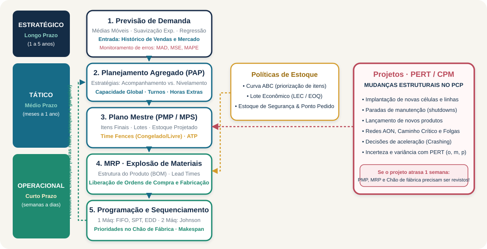

.pull-left[
- **1. Nível Estratégico (Olhar longe):**  
  A direção decide: *"Quantos carros ou celulares vamos vender nos próximos anos? Precisamos construir uma fábrica nova?"*
- **2. Nível Tático (Olhar os próximos meses):**  
  O PCP planeja: *"Quantas unidades de cada modelo faremos a cada mês? Precisamos contratar mais funcionários?"*
]

.pull-right[
- **3. Nível Operacional (Olhar o hoje e o amanhã):**  
  O chão de fábrica executa: *"Quais parafusos comprar agora? Qual máquina vai cortar a chapa nesta manhã?"*
- **E os Projetos (PERT/CPM)?**  
  São as pontes! São as reformas, as máquinas novas e os lançamentos de produtos que preparam a fábrica para o futuro!
]

---

# O Mapa da Conectividade: Tudo está ligado!

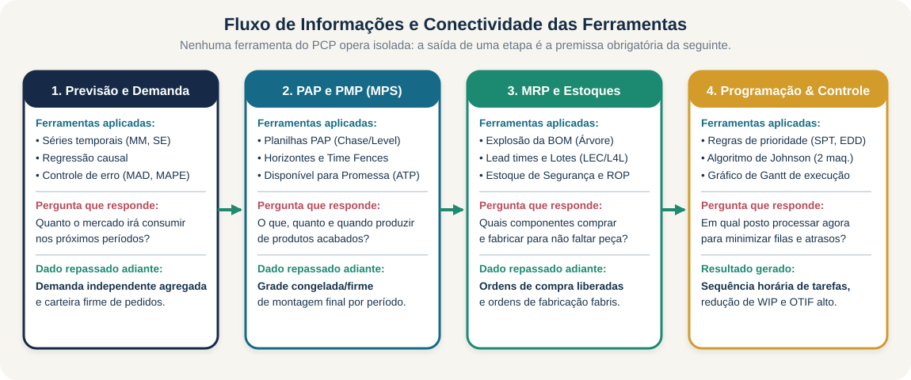

.pull-left[
- **Previsão de Vendas:** alimenta o **Plano da Fábrica (PMP)**;
- **PMP &amp; MRP:** calculam quais peças comprar e fabricar no tempo certo;
]

.pull-right[
- **Chão de Fábrica:** organiza a fila de máquinas e a produção diária;
- **Projetos (PERT/CPM):** se a instalação de uma máquina atrasa, o plano todo é afetado!
]

.clear[]

---

class: compact

# 5 Lições de Ouro para Levar para a Vida!

.pull-left[
1. **Trabalho em equipe é paralelo:** Dividir tarefas reduz o tempo total de qualquer trabalho ou evento escolar.
2. **Identifique o seu Caminho Crítico:** Descubra qual é a tarefa que ninguém pode enrolar e foque nela primeiro!
3. **Use as folgas com inteligência:** Aproveite as tarefas não críticas para respirar e ajudar os colegas mais sobrecarregados.
]

.pull-right[
4. **Prepare-se para imprevistos (PERT):** Nunca planeje nada contando apenas com o melhor dos mundos.
5. **Planejar e Controlar é agir a tempo:** Quando algo sair dos trilhos, recalcule os caminhos e tome decisões rápidas!
]

.clear[]

.decision[**Parabéns!** Agora você já sabe como grandes engenheiros e líderes organizam projetos gigantescos e garantem entregas no prazo!]
---

class: inverse, center, middle

# Bastidores da Pesquisa Operacional

.large[Qual método matemático o CPM usa para encontrar o Caminho Máximo?]

---

class: compact

# 1. A Rede como um Grafo Acíclico (DAG) e Programação Dinâmica

Na **Pesquisa Operacional (P.O.)**, o problema do Caminho Crítico é formalmente o **Problema do Caminho Mais Longo (*Longest Path Problem*)**.

.pull-left[
### 🔄 Por que o problema é tratável no CPM?
- Em grafos gerais com ciclos, achar o caminho mais longo é um problema **NP-difícil** (sem solução rápida conhecida);
- Mas uma rede de projeto é um **DAG (*Directed Acyclic Graph*)**: tarefas nunca formam loops (o tempo só anda para a frente!);
- Em um DAG, podemos fazer uma **ordenação topológica** dos nós da esquerda para a direita.
]

.pull-right[
### ⚡ A Equação de Recursão de Bellman
O algoritmo do CPM nada mais é do que **Programação Dinâmica**:

$$\text{ES}_j = \max_{i \in \text{Pred}(j)} \{ \text{ES}_i + d_i \}$$

- **Princípio da Otimalidade de Bellman:** O caminho máximo até o nó $j$ é a soma do caminho ótimo até $i$ mais a duração $d_i$;
- **Complexidade Linear:** $\mathcal{O}(V + E)$ — calcula projetos com milhares de tarefas em frações de segundo!
]

.clear[]

.decision[**Conclusão da P.O.:** A caminhada da "Ida" é a **Programação Dinâmica de Bellman** resolvida diretamente sobre a ordem topológica da rede!]

---

class: compact

# 2. O Olhar da Programação Linear (Modelo Primal-Dual)

O CPM também pode ser formulado com total rigor como um **Problema de Programação Linear (PL)** contínuo:

.pull-left[
### 🎯 Modelo Primal (Minimizar o Prazo Final)
Definindo $t_i$ como o instante de ocorrência do evento $i$:
$$\min \quad (t_{\text{fim}} - t_{\text{início}})$$
**Sujeito às restrições de precedência:**
$$t_j - t_i \ge d_{ij} \quad \forall (i,j) \in \text{Arcos}$$

- Cada restrição garante que a tarefa $j$ só começa após o término da predecessora $i$.
]

.pull-right[
### ⚖️ O Dual da Programação Linear
Pelo **Teorema da Dualidade Forte**:
- As **variáveis duais** ($\lambda_{ij} \ge 0$) medem a sensibilidade de cada restrição;
- Se $\lambda_{ij} > 0 \implies$ o arco $(i,j)$ tem **Folga Zero** e está no **Caminho Crítico**!
- O valor da variável dual é o "preço-sombra": quanto o projeto atrasa se aquela tarefa atrasar 1 dia.
]

.clear[]

.tip[**Aplicação Prática:** Esse modelo de Programação Linear é o coração dos algoritmos de compressão de prazos e custos (*crashing*) em softwares corporativos de PCP!]

---

class: compact

# Síntese: Os 3 Pilares do CPM na Pesquisa Operacional

| Abordagem Matemática | O que ela faz na prática? | Principal Vantagem no PCP |
|---|---|---|
| **1. Programação Dinâmica (Bellman)** | Executa a Ida ($\max$) e a Volta ($\min$) seguindo a ordenação topológica do DAG. | Velocidade instantânea $\mathcal{O}(V+E)$; intuitivo para ensinar e calcular à mão. |
| **2. Programação Linear (Primal)** | Modela as datas de cada nó com inequações lineares de precedência $t_j - t_i \ge d_{ij}$. | Permite acoplar restrições de orçamento, recursos escassos e marcos contratuais. |
| **3. Teoria da Dualidade** | Identifica os gargalos através das variáveis duais positivas ($\lambda > 0$). | Base matemática exata para análise de sensibilidade e trade-off tempo-custo (*crashing*). |

.decision[**Em resumo:** O CPM encontra o caminho máximo de forma simples e ultraveloz porque a flecha do tempo impede ciclos, permitindo que a Programação Dinâmica e Linear resolvam o problema com elegância!]
