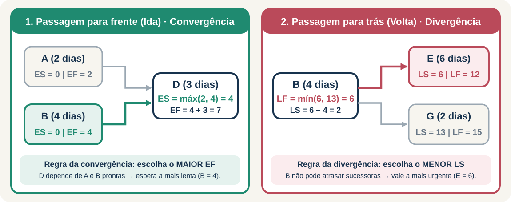

```{r child="setup.Rmd"}
```

class: inverse, center, middle

# Uma lista não mostra dependências

.large[Uma rede mostra o que pode acontecer em paralelo, o que precisa esperar e qual sequência controla o prazo final.]

???

**Pergunta disparadora no quadro:**
"Temos cinco tarefas para instalar uma estação. Podemos somar todas as durações para descobrir o prazo do projeto?"
Se alguém responder que sim, desenhe duas tarefas paralelas de 3 dias e pergunte se o conjunto leva 3 ou 6 dias.

---

# Ao final desta unidade

- diferenciar **CPM** (determinístico) e **PERT** (probabilístico);
- construir e ler uma **rede AON** (*Activity on Node*) a partir de precedências;
- calcular datas mais cedo (**ES, EF**) e mais tarde (**LS, LF**);
- identificar **folgas**, **caminho crítico** e sua representação no **Gantt**;
- estimar durações esperadas e dispersão de prazo com **PERT**;
- avaliar decisões de **compressão de prazo** (*crashing*);
- conectar atrasos ou antecipações do projeto aos níveis de **PMP, MRP e programação**.

---

class: compact

# Roteiro da aula

| Etapa | Aplicação em sala | Tempo sugerido |
|---|---|---:|
| 1 | projetos no PCP, EAP e leitura de precedências | 20 min |
| 2 | anatomia do nó e exemplo guiado de CPM (estação A–E) | 30 min |
| 3 | exemplo integrado (rede A–I), folgas, Gantt e sensibilidade | 30 min |
| 4 | decisão de compressão de prazo (*crashing*) | 15 min |
| 5 | incerteza e risco com PERT | 15 min |
| 6 | oficina da célula produtiva (rede A–H) | 50 min |
| 7 | integração com o PCP e debate das soluções | 20 min |

.decision[As respostas comentadas aparecem após cada pausa para resolução ativa.]

---

# Projetos no contexto da produção

.pull-left[
### Quando usamos PERT/CPM no PCP?
- implantação de nova linha ou célula produtiva;
- paradas programadas de manutenção (*shutdown*);
- lançamento de produto ou troca de ferramental;
- produção sob encomenda de grande porte (navios, turbinas, obras industriais).
]

.pull-right[
### Da EAP (WBS) à rede
1. **EAP (*Work Breakdown Structure*):** decompõe o escopo em pacotes de trabalho e atividades;
2. **Precedências:** define quem depende de quem;
3. **Durações e recursos:** estima tempo e capacidade;
4. **Rede PERT/CPM:** calcula o cronograma e o caminho crítico.
]

.clear[]

.decision[A EAP responde **o que** precisa ser feito; a rede PERT/CPM responde **em que sequência** e **qual atividade governa o prazo**.]

---

class: compact

# CPM e PERT: qual é a diferença?

Embora usados juntos na prática, os dois métodos nasceram na década de 1950 com focos complementares:

| Dimensão | CPM (*Critical Path Method*) | PERT (*Program Evaluation and Review Technique*) |
|---|---|---|
| **Natureza da duração** | **Determinística** (1 estimativa fixa por atividade) | **Probabilística** (3 estimativas: *o*, *m*, *p*) |
| **Foco gerencial** | Controle de prazo, folgas e *trade-off* **tempo × custo** | Incorporação de **incerteza** e risco de atraso |
| **Aplicação típica** | Manutenção industrial, montagem, instalações conhecidas | P&D, inovação, automação inédita ou fornecimento incerto |
| **Pergunta central** | *"Quais atividades não têm margem de atraso e onde comprimir prazo?"* | *"Qual a duração esperada diante da variabilidade das etapas?"* |

.question[Em uma implantação industrial, por que combinamos a estrutura do CPM com as estimativas do PERT nas atividades inéditas?]

???

**Resposta:**
Ambos usam a mesma lógica de rede (passagem para frente, passagem para trás, cálculo de folgas e caminho crítico). Na prática, usa-se duração determinística (CPM) para tarefas padronizadas e três estimativas (PERT) para etapas sujeitas a alta variabilidade, inserindo o tₑ calculado na rede CPM.

---

# Elementos e estruturas lógicas da rede

.pull-left[
- **atividade:** trabalho que consome tempo e recursos;
- **duração:** tempo necessário para concluir a atividade;
- **predecessora:** etapa que precisa terminar antes;
- **sucessora:** etapa liberada pela conclusão de outra;
- **marco (*milestone*):** evento de controle com duração zero (ex.: *Início* e *Fim*).
]

.pull-right[
- **série:** A → B (B espera A terminar);
- **paralelo:** A e B ocorrem simultaneamente;
- **divergência (ramificação):** A libera B e C ao mesmo tempo;
- **convergência (junção):** D só começa quando **todas** as predecessoras (A e B) terminam.
]

.clear[]

.question[Qual estrutura lógica exige atenção redobrada na passagem para frente? E na passagem para trás?]

???

**Resposta:**
- Na **passagem para frente (ida)**, as **convergências** exigem atenção (usa-se o **maior EF** das predecessoras).
- Na **passagem para trás (volta)**, as **divergências** exigem atenção (usa-se o **menor LS** das sucessoras).

---

# Como ler uma rede de atividades (AON)

.pull-left[

]

.pull-right[

**Convenção AON (*Activity on Node*):**

- cada **caixa (nó)** representa uma atividade;
- cada **seta** indica uma condição de liberação;
- **ramificações** mostram frentes paralelas;
- **convergências** mostram dependências múltiplas.

.question[O que pode começar em t = 0? D pode começar assim que A terminar?]
]

???

**Respostas esperadas:**
- A, B e C começam no tempo zero (após o marco de Início).
- D **não** pode começar quando A terminar no dia 2, porque D também depende de B (que só termina no dia 4).
- Há duas convergências: (A, B) → D e (C, D) → E.

---

# Anatomia do nó AON e convenção de siglas


.network-note[**Equivalência de siglas em português:** ES = IMC/DCI · EF = TMC/DCT · LS = IMT/DTI · LF = TMT/DTT]

???

**Dica didática:**
Apresente tanto as siglas em inglês (ES, EF, LS, LF — padrão em softwares e nos diagramas) quanto em português (IMC/DCI, TMC/DCT, IMT/DTI, TMT/DTT — comuns em livros nacionais e provas). Destaque que a linha superior do nó guarda a **Ida (Cedo)** e a linha inferior guarda a **Volta (Tarde)**.

---

class: inverse, center, middle

# Exemplo 1 · Leitura de precedências

.large[Preparação de uma estação de inspeção]

---

# Dados do exemplo 1

| Atividade | Descrição | Predecessora(s) | Duração |
|---|---|---|---:|
| A | Preparar a área | nenhuma | 2 dias |
| B | Receber o equipamento | nenhuma | 4 dias |
| C | Configurar a rede | nenhuma | 3 dias |
| D | Instalar o equipamento | A, B | 3 dias |
| E | Validar a estação | C, D | 2 dias |

.activity[**Em duplas · 5 min:** (1) desenhem a rede AON; (2) identifiquem as convergências; (3) listem todos os caminhos do início ao fim e somem a duração de cada caminho.]

???

**Três perguntas para guiar o desenho no quadro:**
1. Quais atividades não possuem predecessoras? (A, B, C)
2. Quais atividades recebem mais de uma seta? (D recebe A e B; E recebe C e D)
3. Qual atividade encerra o projeto? (E)

---

# Rede lógica e caminhos do exemplo 1


.pull-left[
**Caminhos completos da rede:**
- **Caminho 1:** A → D → E = 2 + 3 + 2 = **7 dias**
- **Caminho 2:** B → D → E = 4 + 3 + 2 = **9 dias**
- **Caminho 3:** C → E = 3 + 2 = **5 dias**
]

.pull-right[
.warning[**Erro clássico:** somar todas as durações resultaria em **14 dias**, ignorando que A, B e C ocorrem em paralelo.]
]

???

**Observação:**
Não antecipe a definição formal de folga ainda; apenas mostre como a enumeração dos caminhos já sugere que a sequência B–D–E (9 dias) impede o projeto de terminar antes do dia 9.

---

# Passagem para frente (Ida · Datas mais cedo)

A passagem para frente percorre a rede **da esquerda para a direita** a partir de t = 0:

<div class="formula">EF = ES + duração</div>

Quando uma atividade depende de **duas ou mais predecessoras** (convergência):

<div class="formula">ES = maior EF das predecessoras</div>

.question[**Verificação rápida:** se uma atividade X depende de três entregas que terminam nos dias 5, 8 e 6, qual é o ES de X? Por quê?]

???

**Resposta da verificação rápida:**
ES de X = máx(5, 8, 6) = 8. Porque X só pode iniciar quando **todas** as três entregas estiverem concluídas; no dia 5 ou 6, a entrega que termina no dia 8 ainda está pendente.

---

# Passagem para frente na rede

.pull-left[

]

.pull-right[

O cálculo começa no início (t = 0) e avança até o fim:

1. fixe **ES = 0** nas atividades sem predecessoras (A, B, C);
2. some a duração para obter **EF** de cada uma;
3. em **D**, compare EF de A (2) e EF de B (4) → **ES de D = 4**;
4. em **E**, compare EF de C (3) e EF de D (7) → **ES de E = 7**.

.decision[A data mais cedo revela o **primeiro instante tecnicamente viável**, respeitando todas as dependências anteriores.]
]

---

# Exemplo 2 · Passagem para frente

Partindo do tempo zero (t = 0), calcule **ES** e **EF** para cada atividade:

| Atividade | Predecessora(s) | Duração | ES (IMC) | EF (TMC) |
|---|---|---:|---:|---:|
| A | — | 2 | 0 | ? |
| B | — | 4 | 0 | ? |
| C | — | 3 | 0 | ? |
| D | A, B | 3 | ? | ? |
| E | C, D | 2 | ? | ? |

.activity[**Individual · 5 min:** complete a tabela e explique qual atividade governa a liberação de D e qual governa a liberação de E.]

---

# Passagem para frente · solução

| Atividade | Duração | ES | EF | Regra aplicada na ida |
|---|---:|---:|---:|---|
| A | 2 | 0 | 2 | inicia em t = 0 → EF = 0 + 2 = 2 |
| B | 4 | 0 | 4 | inicia em t = 0 → EF = 0 + 4 = 4 |
| C | 3 | 0 | 3 | inicia em t = 0 → EF = 0 + 3 = 3 |
| D | 3 | **4** | **7** | convergência: máx(EF<sub>A</sub> = 2, EF<sub>B</sub> = 4) = 4 → EF = 4 + 3 = 7 |
| E | 2 | **7** | **9** | convergência: máx(EF<sub>C</sub> = 3, EF<sub>D</sub> = 7) = 7 → EF = 7 + 2 = 9 |

.decision[O projeto termina no tempo **9 dias**. **B** controla o início de D, e **D** controla o início de E.]

---

# Passagem para trás (Volta · Datas mais tarde)

A passagem para trás percorre a rede **da direita para a esquerda**, partindo do prazo final (LF da última atividade = 9):

<div class="formula">LS = LF − duração</div>

Quando uma atividade libera **duas ou mais sucessoras** (divergência):

<div class="formula">LF = menor LS das sucessoras</div>

.question[**Verificação rápida:** se uma atividade Y libera duas sucessoras com inícios mais tarde LS = 6 e LS = 13, qual é o LF de Y?]

???

**Resposta da verificação rápida:**
LF de Y = mín(6, 13) = 6. Se Y terminasse no dia 13, atrasaria a primeira sucessora em 7 dias. Logo, na volta prevalece a restrição mais apertada (o menor LS).

---

# Síntese visual · Convergência na ida vs. Divergência na volta



.decision[**Regra de bolso:** na **ida** (convergência) esperamos a mais lenta (**maior EF**); na **volta** (divergência) respeitamos a mais urgente (**menor LS**).]

---

# Passagem para trás na rede

.pull-left[

]

.pull-right[

O cálculo parte do fim (t = 9) e retorna ao início:

1. fixe **LF de E = 9** → LS de E = 9 − 2 = 7;
2. **D** e **C** antecedem E → LF de D = LF de C = 7;
3. calcule LS de D = 7 − 3 = 4 e LS de C = 7 − 3 = 4;
4. **A** e **B** antecedem D → LF de A = LF de B = 4.

.decision[As datas mais tarde mostram **até quando** cada atividade pode iniciar ou concluir sem atrasar o projeto.]
]

---

# Exemplo 3 · Passagem para trás

Adotando a duração total de **9 dias**, calcule **LF** e **LS** de E até A:

| Atividade | Sucessora(s) | Duração | ES | EF | LS (IMT) | LF (TMT) |
|---|---|---:|---:|---:|---:|---:|
| E | Fim | 2 | 7 | 9 | ? | 9 |
| D | E | 3 | 4 | 7 | ? | ? |
| C | E | 3 | 0 | 3 | ? | ? |
| B | D | 4 | 0 | 4 | ? | ? |
| A | D | 2 | 0 | 2 | ? | ? |

.activity[**Trios · 7 min:** preencham a tabela de E até A e expliquem por que A e B recebem o mesmo LF = 4.]

---

# Passagem para trás · solução

| Atividade | Duração | ES | EF | LS | LF | Regra aplicada na volta |
|---|---:|---:|---:|---:|---:|---|
| E | 2 | 7 | 9 | **7** | **9** | atividade final: LF<sub>E</sub> = 9 → LS<sub>E</sub> = 9 − 2 = 7 |
| D | 3 | 4 | 7 | **4** | **7** | entrega para E: LF<sub>D</sub> = LS<sub>E</sub> = 7 → LS<sub>D</sub> = 7 − 3 = 4 |
| C | 3 | 0 | 3 | **4** | **7** | entrega para E: LF<sub>C</sub> = LS<sub>E</sub> = 7 → LS<sub>C</sub> = 7 − 3 = 4 |
| B | 4 | 0 | 4 | **0** | **4** | entrega para D: LF<sub>B</sub> = LS<sub>D</sub> = 4 → LS<sub>B</sub> = 4 − 4 = 0 |
| A | 2 | 0 | 2 | **2** | **4** | entrega para D: LF<sub>A</sub> = LS<sub>D</sub> = 4 → LS<sub>A</sub> = 4 − 2 = 2 |

.decision[Tanto A quanto B precisam estar concluídas até **t = 4**, que é o início mais tarde de D (LS<sub>D</sub> = 4).]

---

class: compact

# Folga total e caminho crítico

<div class="formula">Folga total (FT) = LS − ES = LF − EF</div>

.pull-left[
| Atividade | ES | EF | LS | LF | Folga | Status |
|---|---:|---:|---:|---:|---:|---|
| A | 0 | 2 | 2 | 4 | **2** | não crítica |
| **B** | 0 | 4 | 0 | 4 | **0** | **crítica** |
| C | 0 | 3 | 4 | 7 | **4** | não crítica |
| **D** | 4 | 7 | 4 | 7 | **0** | **crítica** |
| **E** | 7 | 9 | 7 | 9 | **0** | **crítica** |
]

.pull-right[

]

.clear[]

.decision[O caminho crítico é **B – D – E** (9 dias, folga zero). É o **caminho mais longo** da rede, que determina a duração mínima do projeto.]

---

# Visualizando as folgas no gráfico de Gantt


.network-note[**Leitura do Gantt:** as barras tracejadas mostram o intervalo em que **A** (2 dias) e **C** (4 dias) podem flutuar sem deslocar t = 9.]

???

**Dica didática com o Gantt:**
Mostre que:
1. O caminho crítico **B → D → E** forma uma escada contínua de t = 0 a t = 9 sem nenhuma folga.
2. **Folga Total vs. Folga Livre:** em A, como D só começa em t = 4 (ES de D = 4), os 2 dias de folga de A não atrasam nem mesmo o início mais cedo de D. Essa visualização ajuda também a nivelar recursos (ex.: deslocar C dentro da janela 0–7 se compartilhar equipe com A ou B).

---

# O que significa "atividade crítica" na prática?

- **No método CPM:** atividade crítica é aquela com **folga total igual a zero** (LS = ES e LF = EF).
- **Atenção gerencial:** não significa a tarefa mais cara ou mais complexa tecnicamente, mas aquela sem margem temporal.
- **Uso das folgas:** atividades não críticas (como A e C) oferecem flexibilidade para **nivelar recursos** ou absorver pequenos imprevistos.

.question[Se A atrasar 1 dia, o prazo final do projeto muda? E se A atrasar 3 dias?]

???

**Resposta:**
- Se A atrasar **1 dia**, termina no dia 3; como A tem 2 dias de folga (LF de A = 4), o projeto **não atrasa** (continua terminando em 9 dias).
- Se A atrasar **3 dias**, termina no dia 5; consome os 2 dias de folga e atrasa D (e o projeto) em **1 dia** (passando para 10 dias).

---

class: inverse, center, middle

# Exemplo Integrado · Rede de 9 Atividades (A a I)

.large[Aplicação completa: convergências múltiplas, datas cedo/tarde, folgas, Gantt e sensibilidade]

---

class: compact

# Enunciado do Exemplo 2 da referência

Um projeto industrial foi definido contendo as seguintes atividades, durações e predecessoras:

| Atividade | Descrição técnica do pacote | Duração | Predecessora(s) |
|---|---|---:|---|
| **A** | Alinhamento de escopo e requisitos | 1 dia | — |
| **B** | Projeto e especificação mecânica | 4 dias | A |
| **C** | Especificação de sensores e automação | 3 dias | A |
| **D** | Aquisição de insumos estruturais | 7 dias | A |
| **E** | Fabricação da estrutura mecânica | 6 dias | B |
| **F** | Montagem e cabeamento de sensores | 2 dias | C, D |
| **G** | Integração mecânica e elétrica | 7 dias | E, F |
| **H** | Testes estáticos de carga estrutural | 9 dias | D |
| **I** | Comissionamento e validação final | 4 dias | G, H |

.activity[**Desafio em duplas (10 min):** (1) desenhem a rede AON e listem todos os caminhos; (2) calculem ES, EF, LS e LF; (3) montem o gráfico de Gantt; (4) respondam: *o que acontece se a atividade F demorar 4 dias ao invés de 2?*]

---

# Exemplo 2 · Rede AON e enumeração de caminhos


.pull-left[
**Caminhos completos do Início ao Fim:**
- **C1:** A → B → E → G → I = 1 + 4 + 6 + 7 + 4 = **22 dias**
- **C2:** A → C → F → G → I = 1 + 3 + 2 + 7 + 4 = **17 dias**
]

.pull-right[
- **C3:** A → D → F → G → I = 1 + 7 + 2 + 7 + 4 = **21 dias** *(quase crítico!)*
- **C4:** A → D → H → I = 1 + 7 + 9 + 4 = **21 dias** *(quase crítico!)*
]

.clear[]

.decision[A enumeração indica **C1 (22 dias)** como o caminho mais longo. Mas atenção a C3 e C4: ambos têm 21 dias (apenas **1 dia de folga**!).]

---

# Exemplo 2 · Passagem para frente (Datas mais cedo)


.pull-left[
- **A (início):** ES = 0 → EF = 0 + 1 = **1**;
- **B, C, D (liberadas por A):** iniciam em ES = 1;
- **E (após B):** ES = 5 → EF = 5 + 6 = **11**;
- **F (convergência C e D):** máx(EF<sub>C</sub> = 4, EF<sub>D</sub> = 8) = **8** → EF = 8 + 2 = **10**;
]

.pull-right[
- **G (convergência E e F):** máx(EF<sub>E</sub> = 11, EF<sub>F</sub> = 10) = **11** → EF = 11 + 7 = **18**;
- **H (após D):** ES = 8 → EF = 8 + 9 = **17**;
- **I (convergência G e H):** máx(EF<sub>G</sub> = 18, EF<sub>H</sub> = 17) = **18** → EF = 18 + 4 = **22 dias**.
]

.clear[]

.decision[**Regra da ida:** em cada convergência (F, G, I), espera-se a predecessora mais demorada (**maior EF**).]

---

# Exemplo 2 · Passagem para trás e caminho crítico


.pull-left[
- Fixe **LF de I = 22** → LS<sub>I</sub> = 22 − 4 = **18**;
- **G e H (antecedem I):** LF<sub>G</sub> = LF<sub>H</sub> = **18**;
- **E e F (antecedem G):** LF<sub>E</sub> = LF<sub>F</sub> = LS<sub>G</sub> = **11**;
- **D (diverge para F e H):** LF<sub>D</sub> = mín(LS<sub>F</sub> = 9, LS<sub>H</sub> = 9) = **9** → LS<sub>D</sub> = 9 − 7 = **2**;
]

.pull-right[
- **C (antecede F):** LF<sub>C</sub> = LS<sub>F</sub> = **9** → LS<sub>C</sub> = 9 − 3 = **6**;
- **B (antecede E):** LF<sub>B</sub> = LS<sub>E</sub> = **5** → LS<sub>B</sub> = 5 − 4 = **1**;
- **A (diverge para B, C, D):** LF<sub>A</sub> = mín(LS<sub>B</sub> = 1, LS<sub>C</sub> = 6, LS<sub>D</sub> = 2) = **1** → LS<sub>A</sub> = 1 − 1 = **0**.
]

.clear[]

.decision[Caminho crítico contínuo: **A – B – E – G – I** (22 dias, folga zero). D, F e H têm apenas **1 dia de folga**!]

---

class: compact, dense-table

# Exemplo 2 · Quadro completo de datas e folgas

| Atividade | Duração | ES (IMC) | EF (TMC) | LS (IMT) | LF (TMT) | Folga Total (LS − ES) | Criticidade | Interpretação gerencial |
|---|---:|---:|---:|---:|---:|---:|---|---|
| **A** | 1 | 0 | 1 | 0 | 1 | **0** | **Crítica** | Qualquer atraso adia o projeto |
| **B** | 4 | 1 | 5 | 1 | 5 | **0** | **Crítica** | Sem margem temporal |
| **C** | 3 | 1 | 4 | 6 | 9 | **5** | Não crítica | Pode absorver até 5 dias de atraso |
| **D** | 7 | 1 | 8 | 2 | 9 | **1** | Quase crítica | Margem estreita de apenas 1 dia |
| **E** | 6 | 5 | 11 | 5 | 11 | **0** | **Crítica** | Sem margem temporal |
| **F** | 2 | 8 | 10 | 9 | 11 | **1** | Quase crítica | Margem estreita de apenas 1 dia |
| **G** | 7 | 11 | 18 | 11 | 18 | **0** | **Crítica** | Sem margem temporal |
| **H** | 9 | 8 | 17 | 9 | 18 | **1** | Quase crítica | Margem estreita de apenas 1 dia |
| **I** | 4 | 18 | 22 | 18 | 22 | **0** | **Crítica** | Entrega final do projeto |

.decision[**Atenção de PCP:** atividades com folga pequena (D, F e H com 1 dia) devem ser rastreadas como se fossem críticas!]

---

# Exemplo 2 · Gráfico de Gantt com folgas visíveis


.pull-left[
- **Cadeia crítica:** A (0–1), B (1–5), E (5–11), G (11–18) e I (18–22) formam uma escada ininterrupta de 22 dias.
]

.pull-right[
- **Janelas de folga:** C pode flutuar de 4 a 9 (5d de folga); D, F e H têm apenas 1 dia de margem antes de comprometerem suas sucessoras.
]

.clear[]

.decision[O Gantt com folgas permite ao gestor saber **quando pode nivelar recursos ou realocar técnicos** sem comprometer o prazo final.]

---

# Exemplo 2 · Análise de sensibilidade (Efeito se F = 4 dias)


.question[**Pergunta da referência:** *"O que aconteceria se a atividade F fosse revisada para levar 4 dias ao invés de 2?"*]

.decision[**Conclusão:** como F tinha apenas **1 dia de folga**, o aumento de **+2 dias** consome a folga e gera **1 dia de atraso no projeto** (prazo salta de 22 para 23 dias). O caminho crítico **MUDOU** para **A – D – F – G – I**!]

???

**Dica pedagógica para sala de aula:**
Peça aos alunos para recalcular os 4 caminhos antes de mostrar o slide:
1. Caminho A-B-E-G-I continua com 22 dias;
2. Caminho A-D-F-G-I salta de 21 para 23 dias (1 + 7 + 4 + 7 + 4 = 23);
3. Como 23 > 22, o caminho crítico MUDOU!
Essa é a prova mais didática de que **atividades não críticas com folga pequena podem se tornar críticas e ditar o atraso do projeto**.

---

class: inverse, center, middle

# Exemplo 4 · Compressão do prazo (*Crashing*)

.large[A direção precisa liberar a estação em 7 dias]

---

# Protocolo para compressão de prazo (*Crashing*)

Quando é necessário reduzir a duração do projeto (aceleração), siga quatro regras:

1. **Atacar o caminho crítico:** comprimir atividade com folga não reduz o prazo do projeto.
2. **Priorizar menor custo ou menor risco marginal:** escolher a etapa crítica mais viável de acelerar.
3. **Respeitar o limite de paralelismo (ponto de saturação):** ao reduzir o caminho crítico, outro caminho paralelo pode empatar e **tornar-se crítico também**.
4. **Recalcular toda a rede:** após cada redução, conferir os tempos de todos os caminhos.

---

# Decisão de compressão

Para reduzir o projeto da estação de **9 para 7 dias**, avalie as três alternativas:

| Alternativa | Mudança proposta | Efeito sobre recursos / Risco principal |
|---|---|---|
| **1** | antecipar **B** em 2 dias (de 4 para 2 dias) | frete expresso; risco de o fornecedor não cumprir |
| **2** | reduzir **D** em 2 dias (de 3 para 1 dia) | equipe extra na instalação; maior risco de falha de montagem |
| **3** | reduzir **A** em 2 dias (de 2 para 0/1 dia) | pressão sobre equipe de preparação da área |

.activity[**Grupos · 6 min:** comparem o efeito de cada alternativa nos três caminhos (**A–D–E**, **B–D–E** e **C–E**). Qual(is) alternativa(s) atinge(m) 7 dias e o que acontece com o caminho crítico?]

---

class: compact

# Compressão · discussão da solução

| Cenário | Caminho A–D–E | Caminho B–D–E | Caminho C–E | Prazo final | Caminho(s) crítico(s) |
|---|---|---|---|---|---|
| **Original** | 2 + 3 + 2 = 7 d | 4 + 3 + 2 = **9 d** | 3 + 2 = 5 d | **9 dias** | **B–D–E** |
| **Alt. 3 (reduzir A)** | 0 + 3 + 2 = 5 d | 4 + 3 + 2 = **9 d** | 3 + 2 = 5 d | **9 dias** (não reduz!) | **B–D–E** |
| **Alt. 1 (B: 4 → 2 d)** | 2 + 3 + 2 = **7 d** | 2 + 3 + 2 = **7 d** | 3 + 2 = 5 d | **7 dias** | **A–D–E e B–D–E** (duplo!) |
| **Alt. 2 (D: 3 → 1 d)** | 2 + 1 + 2 = 5 d | 4 + 1 + 2 = **7 d** | 3 + 2 = 5 d | **7 dias** | **B–D–E** |

.warning[**Ponto de atenção:** na Alternativa 1, A perde sua folga e a rede passa a ter **dois caminhos críticos**! Na Alternativa 2, como D é comum a A–D–E e B–D–E, apenas B–D–E permanece crítico.]

---

class: inverse, center, middle

# Exemplo 5 · Incerteza com PERT

.large[Uma duração única pode esconder cenários muito diferentes]

---

# Como o PERT incorpora a incerteza


.decision[O PERT pondera **otimista (o)**, **mais provável (m, peso 4)** e **pessimista (p)** pela distribuição Beta, capturando a assimetria dos atrasos.]

---

class: compact

# Estimativa PERT em sala

Considere uma sequência linear de três etapas com incerteza de duração (em dias):

| Atividade | Otimista (o) | Mais provável (m) | Pessimista (p) | Duração esperada (tₑ) | Desvio-padrão (σ) |
|---|---:|---:|---:|---:|---:|
| 1. Projetar o layout | 2 | 3 | 7 | ? | ? |
| 2. Instalar a estação | 4 | 5 | 12 | ? | ? |
| 3. Testar e liberar | 1 | 2 | 6 | ? | ? |

<div class="formula">tₑ = (o + 4m + p) ÷ 6 &nbsp;&nbsp;&nbsp;|&nbsp;&nbsp;&nbsp; σ = (p − o) ÷ 6</div>

.activity[**Duplas · 7 min:** calculem **tₑ** e **σ** para cada atividade e a duração esperada total da sequência. Qual etapa exige maior contingência gerencial?]

---

class: compact

# Estimativa PERT · solução e análise de risco

| Atividade | Cálculo de tₑ = (o + 4m + p) ÷ 6 | tₑ | Amplitude (p − o) | σ = (p − o) ÷ 6 | Variância (σ²) |
|---|---|---:|---:|---:|---:|
| 1. Projetar o layout | (2 + 4 × 3 + 7) ÷ 6 = 21 ÷ 6 | **3,5 dias** | 5 dias | 0,83 d | 0,69 |
| 2. Instalar a estação | (4 + 4 × 5 + 12) ÷ 6 = 36 ÷ 6 | **6,0 dias** | **8 dias** | **1,33 d** | **1,78** |
| 3. Testar e liberar | (1 + 4 × 2 + 6) ÷ 6 = 15 ÷ 6 | **2,5 dias** | 5 dias | 0,83 d | 0,69 |
| **Sequência completa** | 3,5 + 6,0 + 2,5 | **12,0 dias** | — | **√3,16 = 1,78 d** | **3,16** |

.decision[**Leitura gerencial:** a **instalação** concentra a maior incerteza (σ = 1,33 d; cenário pessimista chega a 12 dias). Se planejássemos apenas pela moda (3 + 5 + 2 = 10 dias), subestimaríamos o prazo esperado em **2 dias**!]

---

class: compact

# Erros clássicos em PERT/CPM (e como evitá-los)

Antes de iniciar a oficina, confira as armadilhas mais comuns na resolução de redes:

| Erro frequente | Por que está incorreto? | Regra correta para aplicar |
|---|---|---|
| Somar todas as durações da tabela | Ignora atividades em paralelo | Somar apenas ao longo de cada **caminho** ou fazer a passagem para frente |
| Usar o **menor EF** na convergência (ida) | A sucessora começaria antes de todas as predecessoras terminarem | Na convergência (ida), usar sempre o **maior EF** das predecessoras |
| Usar o **maior LS** na divergência (volta) | A atividade terminaria tarde demais para uma de suas sucessoras | Na divergência (volta), usar sempre o **menor LS** das sucessoras |
| Chamar a atividade mais longa de crítica | Uma atividade longa pode estar em um ramo paralelo com folga | Crítica é apenas a atividade com **Folga Total = 0** (LS − ES = 0) |
| Comprimir atividade sem recalcular a rede | Outro caminho paralelo pode empatar e virar crítico | Sempre **recalcular todos os caminhos** após comprimir uma etapa |

---

# O projeto afeta todo o PCP

.center.large[
Atraso no caminho crítico do projeto  
↓  
Capacidade produtiva indisponível na data prevista  
↓  
**PMP (Plano Mestre)** precisa ser revisto  
↓  
**MRP (Materiais)** precisa ser reprogramado  
↓  
**Programação e sequenciamento** no chão de fábrica mudam
]

.decision[PERT/CPM não produz apenas um calendário de engenharia: ele alimenta a disponibilidade de recursos para o PMP, o MRP e a programação fina.]

---

class: compact

# Exemplo 6 · Efeito de um atraso sobre o PCP

**Cenário:** a nova célula produtiva entregaria **500 unidades na semana 4**, mas uma atividade crítica atrasou a liberação da célula em **1 semana**.

| Nível do PCP | Pergunta decisória | Ação de coordenação possível | Custo ou risco associado |
|---|---|---|---|
| **PMP** | Como atender as 500 unidades prometidas na semana 4? | Antecipar parte do lote em outra linha, usar hora extra ou renegociar entrega | Custo de hora extra ou perda de nível de serviço (OTIF) |
| **MRP** | Quando liberar e receber os componentes da nova célula? | Postergar recebimentos da semana 4 para evitar estoque parado (WIP/MP) | Capital imobilizado e ocupação de almoxarifado se não reprogramar |
| **Programação** | Onde processar as ordens urgentes na semana 4? | Redirecionar ordens críticas para a célula antiga e resequenciar (MDE/MFE) | Aumento de fila, setups extras e possível sobrecarga no recurso antigo |

.activity[**Plenária · 8 min:** qual informação do PERT/CPM a equipe de engenharia deve comunicar primeiro ao PCP quando detectar risco na instalação?]

---

class: inverse, center, middle

# Oficina da unidade

.large[Implantação de uma célula produtiva (Rede A–H)]

Construção da rede, cálculos de CPM, compressão de 2 dias e integração com o PCP.

---

class: compact, dense-table

# Dados da oficina · Implantação da célula produtiva

| Atividade | Descrição | Predecessora(s) | Duração (dias) |
|---|---|---|---:|
| **A** | Definir requisitos | — | 2 |
| **B** | Selecionar equipamentos | A | 4 |
| **C** | Projetar o layout | A | 3 |
| **D** | Preparar a infraestrutura | C | 5 |
| **E** | Adquirir os equipamentos | B | 6 |
| **F** | Instalar os equipamentos | D, E | 3 |
| **G** | Treinar os operadores | B | 2 |
| **H** | Testar e liberar o sistema | F, G | 2 |

.activity[**Em grupos (60 min):** (1) desenhem a rede AON; (2) calculem ES, EF, LS, LF e Folga; (3) identifiquem o caminho crítico; (4) proponham uma compressão de **2 dias**; (5) analisem o impacto de um atraso sobre PMP, MRP e programação.]

???

**Gabarito reservado para o professor (Oficina A–H):**
- **Caminhos:**
  - A–B–E–F–H = 2 + 4 + 6 + 3 + 2 = **17 dias** (**Caminho Crítico**)
  - A–C–D–F–H = 2 + 3 + 5 + 3 + 2 = 15 dias (Folga = 2 dias em C e D)
  - A–B–G–H = 2 + 4 + 2 + 2 = 10 dias (Folga = 7 dias em G)
- **Tabela completa (ES, EF | LS, LF | Folga):**
  - A (2d): ES=0, EF=2 | LS=0, LF=2 | Folga = 0 (Crítica) — *Atenção na volta: A diverge para B (LS=2) e C (LS=4) → LF de A = mín(2, 4) = 2!*
  - B (4d): ES=2, EF=6 | LS=2, LF=6 | Folga = 0 (Crítica) — *Atenção na volta: B diverge para E (LS=6) e G (LS=13) → LF de B = mín(6, 13) = 6!*
  - C (3d): ES=2, EF=5 | LS=4, LF=7 | Folga = 2
  - D (5d): ES=5, EF=10 | LS=7, LF=12 | Folga = 2
  - E (6d): ES=6, EF=12 | LS=6, LF=12 | Folga = 0 (Crítica)
  - F (3d): ES=12, EF=15 | LS=12, LF=15 | Folga = 0 (Crítica) — *Convergência na ida: máx(EF de D=10, EF de E=12) = 12*
  - G (2d): ES=6, EF=8 | LS=13, LF=15 | Folga = 7
  - H (2d): ES=15, EF=17 | LS=15, LF=17 | Folga = 0 (Crítica) — *Convergência na ida: máx(EF de F=15, EF de G=8) = 15*
- **Compressão de 2 dias (de 17 para 15 dias):**
  - Se comprimir **E** (de 6 para 4 dias) ou **B** (de 4 para 2 dias): o caminho A–B–E–F–H cai para 15 dias e empata com A–C–D–F–H (15 dias), criando **dois caminhos críticos**!
  - Se comprimir **A** (em 2d) ou **F** (de 3 para 1 dia) ou **H** (em 2d): como A, F e H pertencem simultaneamente aos dois caminhos mais longos, ambos caem juntos (para 15 e 13 dias), mantendo apenas A–B–E–F–H como crítico.

---

# Entregáveis da oficina

1. **Rede AON** legível com as oito atividades (A a H) e suas setas de precedência;
2. **Quadro completo** com Duração, ES, EF, LS, LF, Folga Total e indicação de criticidade;
3. **Caminho crítico** destacado e duração total do projeto;
4. **Proposta de compressão de 2 dias** com recálculo dos caminhos e verificação de novos caminhos críticos;
5. **Riscos operacionais** da compressão e medidas de controle;
6. **Impactos no PCP** (PMP, MRP e programação) e ação de coordenação.

.decision[Distribuam os papéis na equipe: desenho da rede, passagem para frente, passagem para trás, análise de compressão e integração com o PCP.]

---

# Perguntas para o debate das soluções

- Em quais atividades da rede A–H ocorreu **convergência na ida** (maior EF) e em quais ocorreu **divergência na volta** (menor LS)?
- Qual atividade não crítica possui a **menor folga** e precisa ser monitorada de perto?
- A escolha de comprimir **E** (aquisição) ou **F** (instalação) gera o mesmo número de caminhos críticos após a redução de 2 dias?
- Qual decisão de prazo transfere mais risco para a qualidade ou para o chão de fábrica?
- Que informação do cronograma deve acionar imediatamente a revisão do PMP e do MRP?

---

class: inverse, center, middle

# Síntese do Curso · A Arquitetura Integrada do PCP

.large[Como as ferramentas se conectam para transformar demanda em produtos entregues no prazo]

---

# A arquitetura hierárquica do PCP


.decision[O PCP é um sistema hierárquico integrado: o **longo prazo** define capacidade e previsão; o **médio prazo** equilibra demanda e estoque (PAP/PMP); o **curto prazo** desagrega materiais (MRP) e programa as máquinas. **PERT/CPM** viabiliza as expansões e paradas que transformam o sistema.]

---

# Conectividade das ferramentas · O fluxo de informações


.decision[Nenhuma ferramenta opera isolada: a saída de uma etapa é premissa obrigatória da seguinte. Se a **previsão** errar, o **PMP** oscila; se o **MRP** falhar, o chão de fábrica para; se a **programação** desviar, o cliente não recebe.]

---

class: compact, dense-table

# Matriz decisória das ferramentas do PCP

| Nível | Ferramentas centrais | Pergunta norteadora | Entradas necessárias | Saída / Decisão gerencial |
|---|---|---|---|---|
| **Estratégico** | Previsão de Demanda &amp; Curva ABC | Quanto o mercado consumirá e o que priorizar? | Histórico de vendas, fatores causais e valor financeiro | Previsão agregada e foco nos itens de maior impacto (A) |
| **Tático** | Planejamento Agregado (PAP) | Qual é o ritmo global e o envelope de capacidade? | Previsão agregada e capacidade nominal de fábrica | Estratégia de acompanhamento, nivelamento, turnos ou horas extras |
| **Tático** | Plano Mestre (PMP / MPS) &amp; ATP | O que, quanto e quando produzir de itens finais? | Carteira de pedidos, previsão desagregada e *time fences* | Grade firme de montagem final e promessa confiável de entrega (ATP) |
| **Operacional** | MRP (Explosão de Materiais) &amp; LEC | Quais componentes comprar e fabricar? | Grade do PMP, estrutura do produto (BOM), estoques e lotes | Ordens de compra liberadas a fornecedores e ordens de fabricação |
| **Execução** | Programação Fina &amp; Sequenciamento | Qual ordem processar agora em cada máquina? | Ordens liberadas, tempos de processamento e datas de entrega | Sequência nos centros de trabalho (SPT, EDD, Johnson) e baixo WIP |
| **Projetos** | PERT / CPM (Redes, Folgas, Crashing) | Quando uma nova capacidade ou linha estará pronta? | Precedências, durações (determinísticas ou PERT) e custos | Cronograma do caminho crítico, datas marco e liberação para o PMP |

---

# O papel de PERT/CPM na dinâmica do PCP

.pull-left[
### A rotina contínua de operações
- opera dentro da **capacidade instalada** e dos arranjos existentes;
- responde à demanda do mercado via **PMP, MRP e sequenciamento**;
- busca estabilidade de fluxo, alta produtividade e baixo estoque em processo (*WIP*).
]

.pull-right[
### Os projetos que transformam a fábrica
- implantam novas células, linhas de envase e maquinário;
- executam paradas programadas de manutenção geral (*shutdowns*);
- introduzem novos produtos e alterações de engenharia.
]

.clear[]

.warning[**O elo de integração:** o projeto estabelece **quando** e **com que capacidade** a fábrica poderá operar. Se o caminho crítico de uma implantação atrasa 1 semana, o PMP precisa ser revisto imediatamente para não prometer produtos sem capacidade disponível.]

---

# O ciclo fechado de controle e feedback

.pull-left[
### Quando ocorrem desvios operacionais...
- **quebra de máquina ou retrabalho no posto:** o chão de fábrica aciona regras de sequenciamento e remaneja lotes;
- **fornecedor atrasa componente crítico:** o MRP recalcula necessidades líquidas e consome estoque de segurança;
- **pedido urgente entra na carteira:** o PMP avalia o Disponível para Promessa (ATP) sem violar a cerca congelada;
- **instalação atrasa em atividade com folga:** o projeto absorve o desvio sem deslocar o marco final.
]

.pull-right[
### A essência do PCP
- **planejar** é estabelecer a meta viável e alocar os recursos no tempo;
- **controlar** é comparar o realizado com o previsto e agir antes do colapso;
- o profissional de PCP atua como o **árbitro de equilíbrio** entre a pressão comercial por prazos, a restrição financeira por estoques e a capacidade técnica da fábrica.
]

.clear[]

.decision[O verdadeiro valor do PCP não está em gerar planilhas estáticas, mas em **garantir coordenação ágil entre vendas, compras, engenharia e produção** diante das incertezas do mundo real.]

---

# As cinco coerências de um sistema de produção

.pull-left[
1. **Coerência de Demanda:**  
   diferenciar demanda independente (mercado/PMP) de demanda dependente (BOM/MRP);
2. **Coerência de Materiais:**  
   nenhuma montagem final inicia se faltar um único parafuso no almoxarifado;
3. **Coerência de Capacidade:**  
   nunca liberar ordens para o chão de fábrica além do que os gargalos conseguem processar;
]

.pull-right[
4. **Coerência de Tempo:**  
   respeitar lead times de compra, fabricação, montagem e folgas de projetos;
5. **Coerência de Execução:**  
   fornecer prioridades transparentes (regras de despacho) para que o chão de fábrica cumpra o índice OTIF (*On-Time In-Full*).
]

.clear[]

.decision[**Síntese final:** Planejar e controlar a produção é a ciência e a arte de **manter essas cinco coerências vivas e sincronizadas todos os dias** na indústria.]

---

# Fontes da unidade e referências do curso

- Plano didático e ementa da disciplina (*Planejamento e Controle da Produção*).
- Corrêa, H. L.; Corrêa, C. A. *Administração de Produção e Operações*. São Paulo: Atlas.
- Slack, N.; Brandon-Jones, A.; Johnston, R. *Administração da Produção*. São Paulo: Atlas.
- Tubino, D. F. *Planejamento e Controle da Produção: Teoria e Prática*. São Paulo: Atlas.

.small[Os exemplos numéricos e diagramas vetoriais desta apresentação foram estruturados para resolução ativa em sala.]
